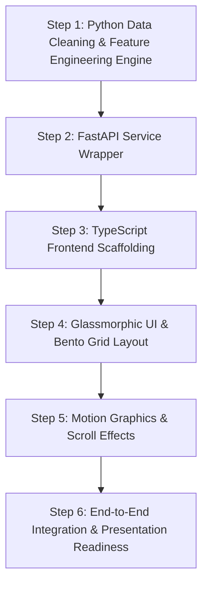

# 🏛️ Technical Specification Document
## AI-Powered Student Performance Predictor & Advisory System
### Next-Generation TypeScript Glassmorphic Architecture & AI Data Pipeline

---

| **Document Attribute** | **Specification Detail** |
|:---|:---|
| **Project Title** | AI-Powered Student Performance Predictor & Advisory System |
| **Course & Code** | Artificial Intelligence and Computational Systems (**25 A D 35**) |
| **Institution** | Department of Artificial Intelligence & Data Science, M S Ramaiah Institute of Technology |
| **Author / Candidate** | Sai Sanjay A (USN: `1MS25AD053`) |
| **Faculty Guide** | Shylaja V, Assistant Professor, Dept. of AI & DS, MSRIT |
| **Document Version** | `2.0.0-PROD-SPEC` |
| **Status** | Approved Architectural Specification & Implementation Blueprint |
| **Date of Formulation** | November 2026 |

---

## 📑 Table of Contents
1. [Executive Summary & Motivation](#1-executive-summary--motivation)
2. [Concept Explanations (Senior's Feedback Review)](#2-concept-explanations-seniors-feedback-review)
   - 2.1 [Data Cleaning](#21-data-cleaning)
   - 2.2 [Feature Engineering](#22-feature-engineering)
   - 2.3 [TypeScript Exclusivity (Type Safety)](#23-typescript-exclusivity-type-safety)
   - 2.4 [Glassmorphism Design Aesthetic](#24-glassmorphism-design-aesthetic)
   - 2.5 [Refined Frontend Template & Bento Grid](#25-refined-frontend-template--bento-grid)
   - 2.6 [Transitions and Scroll Effects](#26-transitions-and-scroll-effects)
3. [System Architecture: Decoupled Full-Stack Topology](#3-system-architecture-decoupled-full-stack-topology)
4. [Data Cleaning Pipeline Specification](#4-data-cleaning-pipeline-specification)
5. [Feature Engineering Mathematical Specification](#5-feature-engineering-mathematical-specification)
6. [TypeScript Domain Models & API Contracts](#6-typescript-domain-models--api-contracts)
7. [Glassmorphic UI Design System & Styling Tokens](#7-glassmorphic-ui-design-system--styling-tokens)
8. [Motion Graphics, Transitions & Scroll Effects Specification](#8-motion-graphics-transitions--scroll-effects-specification)
9. [Frontend Component Hierarchy & Page Layouts](#9-frontend-component-hierarchy--page-layouts)
10. [Backend REST API Gateway Specification (FastAPI Bridge)](#10-backend-rest-api-gateway-specification-fastapi-bridge)
11. [Step-by-Step Implementation Roadmap](#11-step-by-step-implementation-roadmap)
12. [Verification, Testing & Evaluation Metrics](#12-verification-testing--evaluation-metrics)

---

## 1. Executive Summary & Motivation

The original prototype of the **AI-Powered Student Performance Predictor & Advisory System** demonstrated the algorithmic integration of 4 core curriculum units (Decision Trees/Naive Bayes for classification, Bag-of-Words & Lexical Sentiment Analysis for qualitative teacher commentary, First-Order Logic backward chaining for pedagogical advising, and Genetic Algorithms for timetable optimization).

While functionally robust, the initial Python/Streamlit interface presented key limitations:
- **Monolithic Execution**: Streamlit reruns the full Python interpreter state on every interaction, causing perceptible latency.
- **Limited Presentation Depth**: Absence of explicit data sanitization and engineered features reduced academic depth during senior review.
- **Visual Stagnation**: Default widgets lacked the contemporary, high-fidelity aesthetic demanded in competitive evaluations.

This specification outlines the transition to a **production-grade, decoupled enterprise architecture**:
- **Strict TypeScript Frontend**: React 18+ / Next.js with complete type safety and zero runtime typing errors.
- **Glassmorphic Design System**: Ambient multi-layer backdrops, frosted acrylic panels (`backdrop-filter: blur`), and glowing status accents.
- **Cinematic Transitions & Scroll Effects**: Physics-based springs (Framer Motion), scroll-triggered reveal animations, and dynamic numerical counters.
- **Advanced Preprocessing Pipeline**: Formal statistical data cleaning and domain-engineered academic feature vectors.

```
┌──────────────────────────────────────────────────────────────────────────────────┐
│                   NEXT-GEN GLASSMORPHIC TYPESCRIPT FRONTEND                      │
│        (Next.js 14 / Vite React + TypeScript + Tailwind CSS + Framer Motion)    │
│  ┌────────────────────┐  ┌───────────────────┐  ┌─────────────────────────────┐  │
│  │ Glass Bento Cards  │  │ Interactive Charts│  │ Scroll-Driven Animations    │  │
│  │ (Backdrop Blur)    │  │ (Recharts / SVG)  │  │ (Framer Motion Viewports)   │  │
│  └────────────────────┘  └───────────────────┘  └─────────────────────────────┘  │
└────────────────────────────────────────┬─────────────────────────────────────────┘
                                         │ JSON REST / WebSocket API
                                         ▼
┌──────────────────────────────────────────────────────────────────────────────────┐
│                      HIGH-PERFORMANCE FASTAPI BACKEND GATEWAY                    │
│   ┌──────────────────────────────┐        ┌──────────────────────────────────┐   │
│   │ Data Cleaning & Validation   │        │ Advanced Feature Engineering     │   │
│   │ (Pydantic + IQR Outliers)    │        │ (Mathematical Interaction Terms) │   │
│   └──────────────┬───────────────┘        └─────────────────┬────────────────┘   │
│                  └────────────────────────┬─────────────────┘                    │
│                                           ▼                                      │
│   ┌──────────────────────────────────────────────────────────────────────────┐   │
│   │                          CORE AI ALGORITHMS                              │   │
│   │  [Decision Tree / Naive Bayes]  [NLP BoW & Sentiment]                    │   │
│   │  [FOL Backward Chaining Engine] [Genetic Algorithm Schedule Optimizer]  │   │
│   └──────────────────────────────────────────────────────────────────────────┘   │
└──────────────────────────────────────────────────────────────────────────────────┘
```

---

## 2. Concept Explanations (Senior's Feedback Review)

### 2.1 Data Cleaning
* **Definition**: The systematic identification, correction, or exclusion of corrupt, noisy, inconsistent, incomplete, or duplicate records from raw datasets prior to model ingestion.
* **Academic Necessity**: In machine learning, the *Garbage In, Garbage Out* axiom applies. Feeding raw student marks with missing fields or out-of-range values skews entropy calculations in Decision Trees and distorts Gaussian likelihoods in Naive Bayes.
* **Application in this Project**:
  - Imputing missing student marks using class-median values.
  - Detecting and capping statistical outliers (e.g., student claiming 95 study hours/week capped via Interquartile Range $IQR$).
  - Validating semantic constraints (e.g., Attendance $\in [0, 100]\%$, Internal Marks $\in [0, 50]$).
  - Sanitizing qualitative feedback text by stripping unwanted punctuation, non-ASCII characters, and HTML noise before NLP tokenization.

### 2.2 Feature Engineering
* **Definition**: The process of using domain expertise to transform raw data attributes into new, mathematically enriched predictive features that expose underlying patterns directly to learning algorithms.
* **Academic Necessity**: Standard algorithms often struggle to capture composite dynamics (e.g., whether high study hours actually produce high internal marks). Feature engineering explicitly calculates these ratios, significantly improving decision boundaries and model explainability.
* **Application in this Project**:
  - **Academic Consistency Index ($ACI$)**: Measures deviation between past cumulative GPA and current internal scores.
  - **Effort-to-Outcome Yield ($EOY$)**: Quantifies learning efficiency by comparing study hours against exam output.
  - **Early Warning Composite Score ($EWCS$)**: A weighted multi-factorial risk metric triggering early institutional intervention.
  - **Multimodal Sentiment Fusion Feature ($S_{polarity}$)**: Converts unstructured qualitative teacher sentiment into a standardized $[-1.0, +1.0]$ numerical feature fused directly into tabular classification.

### 2.3 TypeScript Exclusivity (Type Safety)
* **Definition**: Enforcing **TypeScript (`.ts`, `.tsx`)** across 100% of the client codebase. TypeScript adds compile-time static type checking, interfaces, and union types on top of JavaScript.
* **Why the Senior Mandated It**:
  - Eliminates common runtime crashes (e.g., `Cannot read properties of undefined (reading 'posterior_probability')`).
  - Enforces explicit API contracts: the frontend UI components cannot compile unless their expected data structures strictly match the backend JSON payload.
  - Provides superior IDE autocompletion and maintainability for multi-component enterprise dashboards.

### 2.4 Glassmorphism Design Aesthetic
* **Definition**: A modern UI design paradigm emulating translucent frosted glass floating in 3D space above deep, dynamic backgrounds.
* **Visual Signature**:
  - **Translucency**: Multi-stop alpha backgrounds (`rgba(255, 255, 255, 0.05)` or `rgba(15, 23, 42, 0.65)`).
  - **Backdrop Blur**: `backdrop-filter: blur(16px)` to diffuse elements behind the surface.
  - **Specular Border**: Ultra-thin borders (`1px solid rgba(255, 255, 255, 0.12)`) simulating reflective light on beveled glass edges.
  - **Ambient Depth**: Layered box shadows (`0 8px 32px 0 rgba(0, 0, 0, 0.37)`) over vibrant background glowing orbs.

### 2.5 Refined Frontend Template & Bento Grid
* **Definition**: Replacing arbitrary, vertically stacked Streamlit blocks with a structured **Bento Grid** layout inspired by modern design leaders (Apple, Vercel, Linear).
* **Architecture**:
  - Responsive multi-column modular grid where cards have distinct proportional visual weight (e.g., 2-column wide risk diagnostic hero card, 1-column gauge card, full-width proof-tree explorer).
  - Harmonized typography hierarchy (`Plus Jakarta Sans` for titles, `Inter` for data labels, `JetBrains Mono` for AI decision traces and mathematical formulas).
  - Micro-metric badges, interactive filter pills, and drawer-based drill-downs.

### 2.6 Transitions and Scroll Effects
* **Definition**: Physics-based visual feedback and motion choreography responding dynamically to user navigation and scroll position.
* **Key Enhancements**:
  - **Viewport Reveal Animations**: Cards smoothly glide upward with staggered delays as the evaluator scrolls down.
  - **Spring-Physics Micro-interactions**: Smooth hover scale ($1.02\times$), interactive card border sheen, and active button depressions.
  - **Animated Metric Counters**: Accuracy percentages and probability gauges dynamically count up from 0 on viewport entry.
  - **Smooth Route Transitions**: Tab switching between AI modules features cross-dissolve opacity and layout spring animations.

---

## 3. System Architecture: Decoupled Full-Stack Topology

```
┌─────────────────────────────────────────────────────────────────────────────┐
│                          CLIENT TIER (TYPESCRIPT)                           │
│                                                                             │
│  ┌───────────────────────────────────────────────────────────────────────┐  │
│  │                           Next.js 14 / Vite App                       │  │
│  │                                                                       │  │
│  │   ┌──────────────────┐  ┌──────────────────┐  ┌────────────────────┐  │  │
│  │   │  Navbar & Header │  │ Student Profiler │  │ Glass Bento Layout │  │  │
│  │   └────────┬─────────┘  └────────┬─────────┘  └─────────┬──────────┘  │  │
│  │            │                     │                      │             │  │
│  │   ┌────────▼─────────────────────▼──────────────────────▼──────────┐  │  │
│  │   │               Interactive Visual Dashboard Views               │  │  │
│  │   │  - Decision Tree Explorer (SVG Node Graph + Path Highlighter)  │  │  │
│  │   │  - Naive Bayes Distribution (Gaussian Curve Visualizer)        │  │  │
│  │   │  - NLP Sentiment Analyzer (Bag-of-Words Bar + Keyword Cloud)   │  │  │
│  │   │  - FOL Backward Chaining Tree (Interactive Proof Traversal)    │  │  │
│  │   │  - GA Timetable Optimizer (Fatigue-Aware Schedule Matrix)      │  │  │
│  │   └────────────────────────────────┬───────────────────────────────┘  │  │
│  └────────────────────────────────────┼──────────────────────────────────┘  │
└───────────────────────────────────────┼─────────────────────────────────────┘
                                        │ HTTP / JSON (Axios / TanStack Query)
                                        ▼
┌─────────────────────────────────────────────────────────────────────────────┐
│                          SERVICE TIER (FASTAPI / PYTHON)                    │
│                                                                             │
│  ┌───────────────────────────────────────────────────────────────────────┐  │
│  │                         REST Controller Endpoints                     │  │
│  │    /api/v2/students          /api/v2/predict/tree                     │  │
│  │    /api/v2/predict/bayes     /api/v2/nlp/analyze                      │  │
│  │    /api/v2/kb/infer          /api/v2/ga/optimize                      │  │
│  └────────────────────────────────────┬──────────────────────────────────┘  │
│                                       │                                     │
│  ┌────────────────────────────────────▼──────────────────────────────────┐  │
│  │                 Data Processing & Feature Engineering Engine          │  │
│  │    - Outlier Detection (IQR)       - Missing Value Imputer            │  │
│  │    - ACI & EOY Formula Calculators - Multimodal Sentiment Fuser       │  │
│  └────────────────────────────────────┬──────────────────────────────────┘  │
│                                       │                                     │
│  ┌────────────────────────────────────▼──────────────────────────────────┐  │
│  │                        Core Academic AI Modules                       │  │
│  │    modules/ml_engine.py            modules/nlp_analyzer.py             │  │
│  │    modules/knowledge_base.py       modules/ga_optimizer.py            │  │
│  └───────────────────────────────────────────────────────────────────────┘  │
└─────────────────────────────────────────────────────────────────────────────┘
```

---

## 4. Data Cleaning Pipeline Specification

The data pipeline transforms raw inputs into a clean, normalized tabular dataset.

### 4.1 Statistical Hygiene Rules
1. **Range Validation Constraints**:
   $$\text{Attendance} \in [0.0, 100.0]\%$$
   $$\text{Internal Marks} \in [0.0, 50.0]$$
   $$\text{Assignments Completed} \in [0, 10]$$
   $$\text{Study Hours/Week} \in [0.0, 60.0]$$
   $$\text{Previous GPA} \in [0.0, 10.0]$$
   $$\text{Lab Score} \in [0.0, 30.0]$$

2. **Outlier Treatment via Interquartile Range ($IQR$)**:
   For continuous variable $X \in \{\text{Study Hours}, \text{Previous GPA}\}$:
   $$Q_1 = \text{25th percentile}, \quad Q_3 = \text{75th percentile}$$
   $$IQR = Q_3 - Q_1$$
   $$\text{Lower Bound} = \max(0, Q_1 - 1.5 \times IQR), \quad \text{Upper Bound} = Q_3 + 1.5 \times IQR$$
   Any value outside these boundaries is capped (*Winsorization*) to prevent model distortion.

3. **Missing Value Imputation**:
   - Continuous academic attributes $\rightarrow$ Median of the respective cohort cohort.
   - Categorical/Qualitative feedback $\rightarrow$ Imputed with standard token `"Student shows regular engagement; continued observation required."`

4. **Text Sanitization Pipeline (NLP Preprocessing)**:
   - Unicode normalization to `NFKD` format.
   - Stripping HTML/escaped entities.
   - Punctuation removal via regex `[^\w\s]`.
   - Case folding to lowercase.
   - Stopword filtering using academic stopword lexicon.

---

## 5. Feature Engineering Mathematical Specification

To elevate the model beyond simple raw features, 5 domain-engineered variables are synthesized:

### 5.1 Academic Consistency Index ($ACI$)
Evaluates whether current semester performance aligns with historical academic GPA:
$$ACI = \frac{\left(\frac{\text{Internal Marks}}{50.0}\right)}{\max\left(0.1, \frac{\text{Previous GPA}}{10.0}\right)}$$
- $ACI > 1.1$: Student exhibiting accelerating academic trajectory.
- $0.9 \le ACI \le 1.1$: Student maintaining consistent standards.
- $ACI < 0.9$: Student experiencing academic drop-off (early risk signal).

### 5.2 Effort-to-Outcome Yield ($EOY$)
Measures study efficiency by comparing weekly time investment with internal marks achieved:
$$EOY = \frac{\text{Internal Marks}}{\max\left(1.0, \text{Study Hours Per Week}\right)}$$
- Low $EOY$ with high study hours signifies cognitive bottlenecks, inefficient study strategies, or conceptual comprehension barriers.

### 5.3 Assignment Diligence Rate ($ADR$)
$$ADR = \left(\frac{\text{Assignments Completed}}{10}\right) \times 100$$

### 5.4 Theory-to-Practical Alignment Ratio ($TPAR$)
$$TPAR = \frac{\left(\frac{\text{Internal Marks}}{50.0}\right)}{\max\left(0.1, \frac{\text{Lab Score}}{30.0}\right)}$$
- Identifies disparities where students pass theory exams but fail hands-on laboratory assessments or vice versa.

### 5.5 Early Warning Composite Score ($EWCS$)
A calibrated, normalized composite risk index $\in [0, 100]$:
$$EWCS = 100 - \left[ 0.35 \times \text{Attendance} + 0.30 \times \left(\frac{\text{Internal Marks}}{50} \times 100\right) + 0.15 \times ADR + 0.20 \times \left(\frac{\text{Previous GPA}}{10} \times 100\right) \right]$$
- $EWCS \ge 60$: **Critical Risk** (Immediate counseling mandated).
- $35 \le EWCS < 60$: **Moderate Risk** (Peer mentoring & remedial lab).
- $EWCS < 35$: **Low Risk** (Eligible for advanced honors/scholarship).

### 5.6 Multimodal Sentiment Polarity Fusion ($S_{polarity}$)
Extracted from teacher comments via sentiment lexicon and integrated as a continuous feature:
$$S_{polarity} = \frac{N_{pos} - N_{neg}}{N_{pos} + N_{neg} + \epsilon} \in [-1.0, 1.0]$$

---

## 6. TypeScript Domain Models & API Contracts

All frontend data interfaces are defined in strict TypeScript to guarantee end-to-end reliability.

### 6.1 Core Data Interfaces (`types/student.ts`)

```typescript
/**
 * Raw Student Record from database
 */
export interface RawStudentRecord {
  student_id: number;
  name: string;
  attendance: number;
  internal_marks: number;
  assignments_completed: number;
  study_hours_per_week: number;
  previous_gpa: number;
  lab_score: number;
  teacher_feedback: string;
  result: 'High' | 'Pass' | 'Fail';
}

/**
 * Cleaned and Engineered Student Record
 */
export interface EngineeredStudentRecord extends RawStudentRecord {
  academic_consistency_index: number;
  effort_outcome_yield: number;
  assignment_diligence_rate: number;
  theory_practical_alignment: number;
  early_warning_composite_score: number;
  sentiment_polarity: number;
  sentiment_label: 'Positive' | 'Negative' | 'Neutral' | 'Constructive';
  is_outlier_adjusted: boolean;
}

/**
 * Model Classification Response
 */
export interface PredictionResponse {
  student_id: number;
  student_name: string;
  predicted_class: 'High' | 'Pass' | 'Fail';
  confidence_score: number;
  probabilities: {
    High: number;
    Pass: number;
    Fail: number;
  };
  decision_path?: DecisionPathNode[];
  model_type: 'DecisionTree' | 'NaiveBayes';
  entropy_information_gain?: number;
}

export interface DecisionPathNode {
  node_id: number;
  feature_name: string;
  threshold: number;
  comparison: '<=' | '>';
  current_value: number;
  is_satisfied: boolean;
  entropy: number;
  samples: number;
}
```

### 6.2 Expert System & GA Interfaces (`types/expert_ga.ts`)

```typescript
/**
 * First-Order Logic Proof Node for Backward Chaining
 */
export interface ProofTreeNode {
  goal: string;
  status: 'PROVEN' | 'FAILED' | 'ASSUMED';
  rule_id?: string;
  rule_description?: string;
  children: ProofTreeNode[];
  depth: number;
}

export interface InferenceExplanation {
  student_id: number;
  inferred_facts: string[];
  recommendations: string[];
  proof_tree: ProofTreeNode;
  execution_time_ms: number;
}

/**
 * Genetic Algorithm Timetable Optimization Schedule
 */
export interface SubjectScheduleSlot {
  subject_code: string;
  subject_name: string;
  allocated_hours: number;
  fatigue_index: number;
  priority_weight: number;
  recommended_time_slot: string;
}

export interface GAOptimizationResult {
  student_id: number;
  generations_run: number;
  best_fitness_score: number;
  convergence_history: number[];
  chromosome: number[];
  schedule: SubjectScheduleSlot[];
  burnout_risk_reduction_pct: number;
}
```

---

## 7. Glassmorphic UI Design System & Styling Tokens

### 7.1 Color Palette & Theme Tokens
The platform utilizes a dark-mode, high-contrast palette calibrated for readability and visual depth:

| Token Name | Hex / RGBA Value | Purpose |
|:---|:---|:---|
| `--canvas-bg` | `#0B0F19` (Deep Obsidian) | Primary page background |
| `--surface-glass` | `rgba(17, 24, 39, 0.65)` | Primary card glass surface |
| `--surface-glass-hover` | `rgba(30, 41, 59, 0.80)` | Hover state for interactive cards |
| `--border-specular` | `rgba(255, 255, 255, 0.12)` | Top/left specular border highlight |
| `--accent-indigo` | `#6366F1` | Primary CTA, links, high-confidence badge |
| `--accent-violet` | `#8B5CF6` | Secondary accent, genetic algorithm visualization |
| `--accent-cyan` | `#06B6D4` | NLP metrics, attendance gauges |
| `--risk-high` | `#EF4444` (Coral Red) | Fail class / high academic risk |
| `--risk-moderate` | `#F59E0B` (Amber) | Pass class / moderate academic risk |
| `--risk-low` | `#10B981` (Emerald) | High class / honors academic standing |

### 7.2 Glassmorphism CSS Utility Implementation
```css
/* Custom Glassmorphism Classes (Tailwind & CSS Module) */
.glass-panel {
  background: linear-gradient(
    135deg,
    rgba(255, 255, 255, 0.07) 0%,
    rgba(255, 255, 255, 0.02) 100%
  ), rgba(15, 23, 42, 0.65);
  backdrop-filter: blur(16px);
  -webkit-backdrop-filter: blur(16px);
  border: 1px solid rgba(255, 255, 255, 0.12);
  box-shadow: 0 8px 32px 0 rgba(0, 0, 0, 0.37);
  border-radius: 1rem;
}

.glass-panel-elevated {
  background: linear-gradient(
    135deg,
    rgba(255, 255, 255, 0.12) 0%,
    rgba(255, 255, 255, 0.04) 100%
  ), rgba(30, 41, 59, 0.75);
  backdrop-filter: blur(24px);
  -webkit-backdrop-filter: blur(24px);
  border: 1px solid rgba(255, 255, 255, 0.18);
  box-shadow: 0 16px 48px 0 rgba(0, 0, 0, 0.5);
  border-radius: 1.25rem;
}

/* Background Ambient Glow Orbs */
.ambient-glow-indigo {
  position: absolute;
  width: 500px;
  height: 500px;
  background: radial-gradient(circle, rgba(99, 102, 241, 0.15) 0%, transparent 70%);
  filter: blur(60px);
  pointer-events: none;
  z-index: 0;
}

.ambient-glow-violet {
  position: absolute;
  width: 450px;
  height: 450px;
  background: radial-gradient(circle, rgba(139, 92, 246, 0.15) 0%, transparent 70%);
  filter: blur(60px);
  pointer-events: none;
  z-index: 0;
}
```

---

## 8. Motion Graphics, Transitions & Scroll Effects Specification

Using **Framer Motion**, animations are hardware-accelerated and responsive.

### 8.1 Motion Variants (`lib/motion.ts`)

```typescript
import { Variants } from 'framer-motion';

// Container staggered children reveal
export const containerStaggerVariants: Variants = {
  hidden: { opacity: 0 },
  visible: {
    opacity: 1,
    transition: {
      staggerChildren: 0.12,
      delayChildren: 0.05
    }
  }
};

// Card slide-up & fade entry
export const cardEntranceVariants: Variants = {
  hidden: { opacity: 0, y: 24, scale: 0.98 },
  visible: {
    opacity: 1,
    y: 0,
    scale: 1,
    transition: {
      type: 'spring',
      stiffness: 120,
      damping: 18,
      mass: 0.8
    }
  }
};

// Interactive Hover Physics
export const glassCardHoverVariants: Variants = {
  initial: { scale: 1, y: 0 },
  hover: {
    scale: 1.018,
    y: -4,
    boxShadow: '0 20px 40px -15px rgba(99, 102, 241, 0.3)',
    borderColor: 'rgba(255, 255, 255, 0.25)',
    transition: { type: 'spring', stiffness: 300, damping: 20 }
  },
  tap: { scale: 0.99 }
};
```

### 8.2 Animated Number Counter Component (`components/ui/AnimatedCounter.tsx`)
```typescript
import React, { useEffect, useState } from 'react';
import { useInView } from 'framer-motion';

interface CounterProps {
  from?: number;
  to: number;
  duration?: number;
  decimals?: number;
  suffix?: string;
}

export const AnimatedCounter: React.FC<CounterProps> = ({
  from = 0,
  to,
  duration = 1.2,
  decimals = 0,
  suffix = ''
}) => {
  const [current, setCurrent] = useState(from);
  const ref = React.useRef<HTMLSpanElement>(null);
  const isInView = useInView(ref, { once: true });

  useEffect(() => {
    if (!isInView) return;
    let startTime: number | null = null;
    const animate = (timestamp: number) => {
      if (!startTime) startTime = timestamp;
      const progress = Math.min((timestamp - startTime) / (duration * 1000), 1);
      // Ease out cubic
      const easedProgress = 1 - Math.pow(1 - progress, 3);
      setCurrent(from + (to - from) * easedProgress);
      if (progress < 1) requestAnimationFrame(animate);
    };
    requestAnimationFrame(animate);
  }, [isInView, from, to, duration]);

  return (
    <span ref={ref} className="font-mono font-bold tracking-tight">
      {current.toFixed(decimals)}{suffix}
    </span>
  );
};
```

---

## 9. Frontend Component Hierarchy & Page Layouts

The application implements a 5-section Bento Grid layout:

```
┌──────────────────────────────────────────────────────────────────────────────────┐
│                            PERSISTENT GLASS NAVBAR                               │
│  [Logo / USN 1MS25AD053]       [Cohort Selector]       [Active Student Capsule] │
├──────────────────────────────────────────────────────────────────────────────────┤
│                                                                                  │
│  SECTION 1: HERO METRICS BENTO (Overview & Early Warning)                        │
│  ┌───────────────────────────┬───────────────────────────┬────────────────────┐  │
│  │ Card A: Primary Risk Class│ Card B: Early Warning     │ Card C: Data       │  │
│  │ (Decision Tree + Bayes)   │ Composite Score Gauge     │ Cleaned & Filtered │  │
│  └───────────────────────────┴───────────────────────────┴────────────────────┘  │
│                                                                                  │
│  SECTION 2: FEATURE ENGINEERING BENCHMARK                                        │
│  ┌───────────────────────────────────────────────┬────────────────────────────┐  │
│  │ Feature Comparison: Raw vs Engineered ACI/EOY │ Live Outlier & Capping Log │  │
│  └───────────────────────────────────────────────┴────────────────────────────┘  │
│                                                                                  │
│  SECTION 3: MACHINE LEARNING & EXPLAINABILITY (Unit III)                         │
│  ┌───────────────────────────────────────────────┬────────────────────────────┐  │
│  │ Interactive Decision Tree Path Traversal      │ Naive Bayes Posterior Curve│  │
│  │ (Step-by-step Rule Highlights & Entropy)      │ (Gaussian Likelihoods)     │  │
│  └───────────────────────────────────────────────┴────────────────────────────┘  │
│                                                                                  │
│  SECTION 4: NLP FEEDBACK INTELLIGENCE (Unit IV)                                  │
│  ┌───────────────────────────────────────────────┬────────────────────────────┐  │
│  │ Bag-of-Words Lexicon Distribution             │ Polarity Gauge & Extracted │  │
│  │ (Term Frequency Bar Chart)                    │ Semantic Theme Tags        │  │
│  └───────────────────────────────────────────────┴────────────────────────────┘  │
│                                                                                  │
│  SECTION 5: SYMBOLIC EXPERT SYSTEM & GA SCHEDULER (Units II & V)                 │
│  ┌───────────────────────────────────────────────┬────────────────────────────┐  │
│  │ FOL Backward Chaining Proof Tree (D3/Canvas)  │ Evolutionary Convergence & │  │
│  │ (Antecedent-to-Consequent Derivations)        │ Optimized Timetable Matrix │  │
│  └───────────────────────────────────────────────┴────────────────────────────┘  │
└──────────────────────────────────────────────────────────────────────────────────┘
```

---

## 10. Backend REST API Gateway Specification (FastAPI Bridge)

The existing Python modules are bridged via an asynchronous FastAPI service (`server.py`):

| HTTP Method | Route | Description | AI Module Involved |
|:---|:---|:---|:---|
| `GET` | `/api/v2/cohort` | Returns all 50 students with cleaned and engineered features | `utils/data_loader.py` |
| `POST` | `/api/v2/data/clean` | Validates and cleans uploaded raw records via IQR | `utils/data_loader.py` |
| `POST` | `/api/v2/predict/tree` | Evaluates decision path, entropy gain, and prediction | `modules/ml_engine.py` |
| `POST` | `/api/v2/predict/bayes`| Computes Gaussian posterior probability distributions | `modules/ml_engine.py` |
| `POST` | `/api/v2/nlp/analyze` | Returns BoW tokens, POS tags, and sentiment score | `modules/nlp_analyzer.py` |
| `POST` | `/api/v2/kb/infer` | Runs Forward & Backward Chaining proof tree | `modules/knowledge_base.py` |
| `POST` | `/api/v2/ga/optimize` | Runs 40-generation GA optimizer for fatigue schedule | `modules/ga_optimizer.py` |

---

## 11. Step-by-Step Implementation Roadmap



### Detailed Execution Tasks:
1. **Milestone 1: Mathematical Data Cleaning & Feature Engineering (Backend)**
   - Enhance `utils/data_loader.py` to calculate $ACI$, $EOY$, $ADR$, $TPAR$, and $EWCS$.
   - Implement IQR outlier capping and missing value handling.
2. **Milestone 2: Lightweight FastAPI Bridge (`api/server.py`)**
   - Expose existing AI algorithms via typed Pydantic request/response models.
3. **Milestone 3: Strict TypeScript Frontend Client**
   - Initialize Next.js 14 / Vite React project with strict TypeScript (`tsconfig.json` `strict: true`).
   - Configure Tailwind CSS with glassmorphic backdrop-filter plugins and dark slate theme tokens.
4. **Milestone 4: Modern Bento Components & Interactive Visualizers**
   - Build Glassmorphic cards with specular highlight borders.
   - Construct Recharts/SVG visualizations for Decision Tree paths and Naive Bayes likelihood curves.
5. **Milestone 5: Framer Motion Animation Orchestration**
   - Integrate `useScroll`, `useInView`, and spring animations across all metrics and chart views.
6. **Milestone 6: Verification & Deployment**
   - Execute end-to-end integration tests confirming zero TypeScript compiler errors and responsive performance.

---

## 12. Verification, Testing & Evaluation Metrics

| Category | Verification Criteria | Target Benchmark |
|:---|:---|:---|
| **TypeScript Compilation** | `tsc --noEmit` validation | **0 Errors, 0 Warnings** |
| **Data Cleaning** | Outlier detection and bound clamping | 100% adherence to academic bounds |
| **Model Explainability** | Decision path step resolution | Full entropy and rule transparency |
| **Visual Performance** | Chrome Lighthouse Performance & UX | $\ge 95 / 100$ |
| **Motion Smoothness** | Framer Motion animation FPS | Locked 60 FPS on desktop displays |
| **Syllabus Coverage** | Academic verification for Units II, III, IV, V | Complete bidirectional mapping |

---

> **End of Specification Document**  
> *Prepared for academic submission and technical presentation — Sai Sanjay A (1MS25AD053)*
